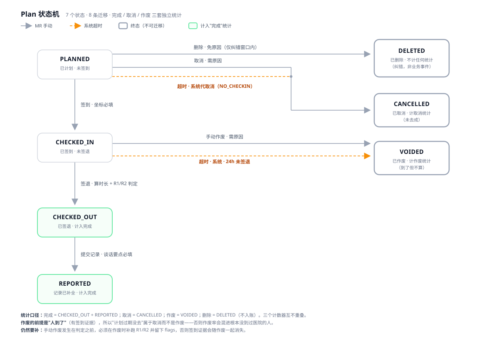

# 三类直接使用者：角色、数据范围与权限边界

> 需求分析补充。原文（`docs/source-extracted.txt`）只写了"不要求实现完整认证与权限"，
> 但**角色决定数据范围**——同一个"按月按产品统计拜访次数"，对三个人是三个不同口径的查询。
> 所以可以不做登录，但不能没有 actor。

---

## 1. 为什么"三类使用者"不是锦上添花

看板需求原文只有一句：「一个按产品维度统计月度拜访次数的看板」。这句话在三个角色嘴里是三个问题：

| 角色 | 同一句需求在他的语境里 | 隐含的 WHERE 子句 |
|---|---|---|
| MR | 我这个月跑了多少、有没有漏填 | `mr_id = me` |
| 主管 | 团队覆盖够不够、哪个产品在掉、异常是不是集中在某个人 | `team_id = my_team` |
| 管理员 | 规则跑出来的异常率是否合理、阈值调了会怎样 | 全量，且按规则版本分组 |

如果 schema 里没有 `mr_id` / `team_id`，看板就只能有一种粒度，主管的问题问不出来。**角色模型的第一产出不是权限表，而是数据模型上的归属字段。**

## 2. 三个角色的目标 → 诉求 → 范围 → 边界

### 2.1 医药代表 MR（张伟）
- **目标**：把计划变成一条合规的拜访记录；别漏填、别被误判异常。
- **诉求**：
  1. 我的拜访计划列表，按状态分组：**待签到 / 进行中（已签到未签退）/ 待补记录 / 已完成**
  2. 到院签到（记录坐标与时间）、签退（自动算时长）
  3. 异常时看到**具体哪条规则、差多少**（"4 分 12 秒，差 48 秒"而不是"异常"）
  4. 签退后才发现异常时，能补充说明（申诉入口，即使后端只存备注）
- **数据范围**：**仅本人**（包括看不到同事的拜访条数）
- **不能做**：看团队看板、改校验规则、代别人签到、**维护药品/医院/医生主数据**（新增或下线药品只有管理员能做）

### 2.2 地区主管 DM（陈静）
- **目标**：团队执行到位 + 合规水位可控。
- **诉求**：
  1. 产品 × 月度拜访次数（原文要求）+ **异常率**（只看次数会被"刷拜访"骗过去）
  2. 下钻：产品 → 代表 → 医院；至少能按代表筛选
  3. 异常明细复核：谁、哪个产品、差在哪
  4. 待办盘点：谁挂着"已签到未签退"（这是最容易被忽略的脏数据来源）
- **能做**：按药品维度查看拜访记录、筛选异常并**复核**（确认异常 / 判为误判，附备注）
- **数据范围**：本团队（其下级 MR）
- **不能做**：代代表签到/签退、改阈值、改主数据；**复核不改判定**，只追加人工结论

### 2.3 合规管理员 ADMIN（王敏）
- **目标**：让规则**正确**且**可审计**。
- **诉求**：
  1. 阈值配置：最短停留时长、最大偏离距离；规则启停
  2. **版本 + 生效时间 + 操作人**（谁在什么时候把 500 改成 800）
  3. 医院主数据维护：**基准坐标**——R2 的唯一输入，坐标错了整批误判
  4. 只读的业务数据视图，用于回归验证（改完阈值，找几条记录看看判定是否符合预期）
- **数据范围**：全局配置与主数据；业务数据只读
- **不能做**：改拜访内容、代签

> 三者共同点：**取消拜访不删除记录**。计划被取消后留痕为 `CANCELLED`，不计入月度拜访次数，但可以查得到——否则"计划了却没拜访"这件事就被抹掉了。

## 3. 权限矩阵

| 能力 | MR | 主管 | 管理员 |
|---|:--:|:--:|:--:|
| 创建拜访计划 | ✅ 本人 | ❌ | ❌ |
| 签到 / 签退 | ✅ 本人 | ❌ | ❌ |
| 提交拜访记录 | ✅ 本人 | ❌ | ❌ |
| 查看拜访明细 | 本人 | 团队 | 全量只读 |
| 产品 × 月度看板 | 本人（"我的"） | 团队 + 代表筛选 | 全量（验证用） |
| 异常明细 | 本人 | 团队 | 全量只读 |
| 异常复核 / 申诉 | 发起 | 处理 | 配置流程 |
| 取消自己的计划 | ✅ 仅 PLANNED | ❌ | ❌ |
| 作废已签到的拜访 | ✅ 发起（填原因） | ✅ 确认 / 驳回 | 只读 |
| 复核异常（确认 / 判为误判） | ❌ | ✅ 只加结论不改判定 | 只读 |
| 医院 / 医生 / 药品主数据 | ❌ 只能选用在架项 | 只读 | ✅ 增删改 + 下线 |
| 规则阈值配置 | ❌ | ❌ | ✅ |
| 规则版本与审计 | 只读可见 | 只读可见 | ✅ |
| 医院主数据（坐标） | ❌ | ❌ | ✅ |

## 4. 由角色推导出的需求（题面没写，但不做会塌）

### R-ROLE-1　actor 与数据范围（≠ 认证）
- **问题**：不做登录，就没有"我是谁"，所有查询都是全量的。
- **建议**：认证可以假（固定 demo 用户 / `X-Actor` 头），但每个查询都必须带 actor 并在服务端过滤；**过滤在服务端做，不在前端做**。
- **验收**：以 MR 身份请求 `/api/visits` 只返回本人记录；越权访问他人拜访返回 404 而不是 403（不泄露存在性）。

### R-ROLE-2　规则版本化 + 判定快照 ★ 最重要
- **问题**：阈值一旦可配置，`abnormal` 就不再是纯函数的结果。若判定只存一个布尔值，管理员今天把 300 秒改成 600 秒，**昨天的合规结论就"变"了**——审计、同比、申诉全部失效。
- **建议**：`evaluation` 保存 `{ flags[], thresholds:{minDurationSec,maxDistanceM}, ruleVersion, evaluatedAt }`；改阈值生成新版本，**默认只影响之后的判定，不回溯**。需要回溯时另跑 re-evaluate 任务并留痕（产生新的判定版本，不覆盖旧值）。
- **验收**：改阈值后，历史拜访的 flags 与 ruleVersion 不变；新签退的拜访带新版本号；看板可按版本筛出"旧口径"数据。

### R-ROLE-3　医院基准坐标的归属与审计
- **问题**：500 米规则依赖医院坐标，但原文没说谁维护它。坐标录错，整个医院的拜访全部误判。
- **建议**：属于管理员的主数据职责；坐标变更记录审计（旧值/新值/人/时间）；**变更不回算历史拜访**。
- **验收**：修改医院坐标后，历史 visit 的判定结果与距离不变。

### R-ROLE-4　悬挂拜访（签到未签退）
- **问题**：只有 MR 的"生命周期"视角才会发现——签了到忘记签退，记录会永远停在 `CHECKED_IN`，既不算完成、也永远算不出时长。
- **建议**：超时策略（如次日 0 点或 24h）自动置为 `UNCLOSED`，并标记异常原因 `CHECKOUT_MISSING`；同时进主管的待办清单。
- **验收**：超过阈值未签退的拜访不再出现在"进行中"，且不参与时长统计。

### R-ROLE-5　看板口径分层
- **问题**：主管要的是"覆盖"，不是"次数"。异常拜访算不算一次拜访？原文没说。
- **建议**：同时给三个数——**拜访次数**（含异常）、**有效拜访次数**（排除异常）、**异常率**；口径写在看板上，而不是藏在文档里。
- **验收**：切换口径后数字可对账（有效 + 异常 = 总数）。

### R-ROLE-6　规则作用域与差异化
- **问题**：三甲医院院区跨度可能超过 500 米，一刀切的阈值会产生系统性误判。
- **建议**：规则支持作用域（全局 / 按医院 / 按产品），优先级从具体到全局；管理员按作用域配置。
- **验收**：同一代表在同一规则下，A 医院 600 米异常、B 医院（配置 1000 米）600 米合规。

### R-ROLE-7　取消计划要留痕，不是删除
- **问题**：代表取消计划如果直接删行，"计划了但没去"就无法被主管看见；`DELETE` 还会破坏审计链路。
- **建议**：`PLANNED → CANCELLED`，记录取消原因、取消人、时间；只有 `PLANNED` 可取消，签到之后必须走完或进异常复核。
- **验收**：取消后不在月度拜访次数里，但按 ID 仍可查；对已签到记录调用取消返回 409。

### R-ROLE-8　机器判定 + 人工复核，两件事分开存
- **问题**：异常如果只能"有/没有"，主管就没有下手的地方；如果复核能改判定，机器与人的结论就混成一个字段，事后无法解释"当初为什么判异常"。
- **建议**：`evaluation.flags`（机器结论，不可变）与 `review{status,by,at,note}`（人工结论）分开存；复核有 `待复核 / 异常已确认 / 误判已驳回` 三态。
- **验收**：复核后 `flags` 与 `abnormal` 不变；看板异常数不变；明细里能同时看到"异常"与"已驳回"。

### R-ROLE-9　主数据用快照 + 逻辑删除，不做物理删除
- **问题**：药品被 200 条拜访引用时物理删除，历史记录就悬空了。
- **决策（已定）**：拜访记录**快照**判定与展示所需的全部主数据字段（医生姓名、科室、药品名、医院名与坐标），
  因此主数据行可以"删除"而不影响历史。但删除只是**逻辑删除**（`deleted_at`），行永远留在库里。
- **为什么不全靠外键 RESTRICT**：RESTRICT 会让"录错的医生"永远删不掉，管理员只能停用，
  列表里越堆越多。快照让删除变成安全的操作。
- **代价（必须承认）**：姓名被快照后，改名不会回溯历史。若"王建国"录错成"王建过"，
  历史记录仍显示错字。所以姓名类字段的变更应改走"主数据修正 + 批量回填脚本（留审计）"，
  而不是指望 join 自动更新。
- **展示规则**：已删除的行不出现在任何下拉与列表；管理员可通过「显示已删除」查看，但不可再操作。

### R-ROLE-10　作废必须是两级：发起权与确认权分离
- **问题**：如果代表能直接作废，就能把任何一次异常拜访"合法地"从统计里抹掉——合规校验当场失效。反过来只给管理员作废，则一线"医生停诊没见到人"的场景要走很长的流程。
- **建议**：代表发起（必填原因）→ 状态 `PENDING`，拜访仍算"进行中"→ 主管确认或驳回（可附备注）。确认后状态 `VOIDED`：不计入拜访次数、异常率与绩效，但签到时间、坐标、原因全部保留。
- **统计口径**：`拜访次数 = 已签到且未作废`；作废单独一列、不进分母。异常复核队列要**排除**已作废与待作废的拜访，否则主管会去复核一件已经不作数的事。
- **验收**：确认作废后该产品当月次数 −1、作废 +1、异常率分母同步变化；驳回后拜访回到原状态，代表仍需签退。

### R-ROLE-11　悬挂拜访的超时是状态机的一条边，不是定时任务的事后补丁
- **问题**：签到后忘记签退，记录永远停在 `CHECKED_IN`：既不算完成、也算不出时长，还会把"进行中"的待办列表撑烂。
- **建议**：把它写成一条**系统迁移**：`CHECKED_IN --(now − checkinAt > 24h)--> VOIDED (cause=TIMEOUT)`。阈值做成系统配置（默认 24 小时），与合规阈值一起版本化。
- **边界**：已有 `PENDING` 作废申请的拜访**不抢流程**（人已经在处理）；已签退（`CHECKED_OUT`）的不适用——那是报表完整性问题，用提醒而不是作废。
- **验收**：超过阈值的 `CHECKED_IN` 在下一次扫描后变 `VOIDED`，看板拜访次数 −1、作废 +1；日志出现"系统超时作废"；代表无法再对该记录签退。

## 4.6　Plan 的状态机（一页纸）

**7 个状态 · 8 条迁移**，完成 / 取消 / 作废 三套独立统计。

| 状态 | 含义 | 可执行动作 | 统计归属 |
|---|---|---|---|
| `PLANNED` | 已计划，未签到 | 签到 / 修改 / 取消 / 删除（窗口内） | 未发生 |
| `CHECKED_IN` | 已签到，未签退 | 签退 / 作废 | 未发生 |
| `CHECKED_OUT` | 已签退，待补记录 | 提交记录（作废窗口已关闭） | **完成** |
| `REPORTED` | 记录已补全 | —（冻结） | **完成** |
| `CANCELLED` | 已取消（未去成 / 超时未签到） | — | **取消** |
| `VOIDED` | 已作废（到了但不算） | — | **作废** |
| `DELETED` | 已删除（纠错，免原因） | — | 不入账 |

| # | 迁移 | 触发 | 守卫 |
|---|---|---|---|
| 1 | `PLANNED → CHECKED_IN` | MR 签到 | 坐标必填且合法 |
| 2 | `CHECKED_IN → CHECKED_OUT` | MR 签退 | 服务端算时长 + 跑 R1/R2，判定固化 |
| 3 | `CHECKED_OUT → REPORTED` | MR 提交记录 | 谈话要点必填 |
| 4 | `PLANNED → CANCELLED` | MR 取消 | **需原因** |
| 5 | `PLANNED → CANCELLED` | 系统超时 | 计划时间 + 24h 未签到（NO_CHECKIN） |
| 6 | `PLANNED → DELETED` | MR 删除 | **免原因**；创建后 1h 内且距开始 &gt; 1h |
| 7 | `CHECKED_IN → VOIDED` | MR 作废 | **需原因**；作废时补判 R2 并留痕 |
| 8 | `CHECKED_IN → VOIDED` | 系统超时 | 签到 + 24h 未签退（TIMEOUT） |

**五条不变量**

1. 时长只能由服务端用两个时间戳算，且只在 `CHECKED_OUT` 之后存在。
2. 判定在签退时固化并带规则版本快照，之后改阈值不回溯。
3. 取消 / 删除 / 作废都不物理删除记录。
4. `REPORTED` 没有出边——已完成即冻结。
5. 一条拜访最终只落进一个计数器（完成 / 取消 / 作废），删除不入账。

**两个刻意的建模选择**

- **作废只从 `CHECKED_IN` 出**：签退的那一刻判定已固化，"看到异常再改"这条路被状态机本身堵死。
- **计划超时归「取消」而不是「作废」**：作废的前提是"人到了"（有签到证据），否则作废率会混进根本没到过医院的人。

## 5. 三方诉求的冲突点，以及一个能同时满足的解法

| | MR 想要 | 主管想要 | 管理员想要 |
|---|---|---|---|
| 阈值 | 松一点，别误判 | 严一点，别放过 | 可调、可追溯 |
| 异常 | 告诉我为什么 | 告诉我谁、多少 | 告诉我规则是否有效 |
| 历史 | 别翻旧账 | 同比要可比 | 不能被悄悄改写 |

冲突的根源是"判定结果"被当成了一个**布尔值**。只要让它变成**带版本的证据**（`flags + thresholds + ruleVersion + evaluatedAt`），三方各自取所需：MR 拿到原因，主管拿到可比的分母，管理员拿到可审计的链路。

## 6. 与现有实现的差距

| 项 | 当前状态 | 缺口 |
|---|---|---|
| 数据归属 | `visit` 有代表字段（`internal/domain` 中 MR 概念存在） | 团队（`team_id`）缺失，主管无法"看本团队" |
| 规则阈值 | `Thresholds` 可注入、有默认值 300/500 | **未持久化版本**，判定结果里没有阈值快照 |
| 判定记录 | `Flag{Code, Detail}` 已落库 | 缺少 `rule_version` / `evaluated_at` / 阈值快照 |
| 主数据 | 医院坐标已在 schema 中 | 无变更审计、无管理员维护入口 |
| 悬挂拜访 | 状态机只到 `REPORTED` | 无 `UNCLOSED` 终态与超时任务 |

> 其中 **R-ROLE-2 是唯一会影响数据库 schema 的一条**：`flags` 表需要加版本列（或在 visit 上存判定的 JSON 快照）。其余都是接口与视图层的增量。

## 7. 需要业务方确认的问题

1. 主管能否看到医生姓名与联系方式？异常明细是否需要脱敏？
2. 阈值是全局一套，还是按医院/产品差异化（决定 R-ROLE-6 是否进一期）？
3. 规则变更是否需要双人复核（四眼原则）？合规场景通常需要。
4. 悬挂拜访多久自动关闭？关闭后是否计为异常、是否影响看板分母？
5. 异常拜访是否影响代表的绩效口径（有些企业只统计"有效拜访"）？

---

## 附：交互原型中的对应实现（一期已确认范围）

`demo/` 里已按本文件做了三档身份切换，可直接对照：

- **MR 张伟** → 只看本人的拜访；可新建、**取消计划**（留痕 `CANCELLED`）、签到/签退/提交记录；
  异常提示给到"差多少秒/多少米"；**看不到药品主数据入口**，越权调用返回 403
- **主管 陈静** → 团队看板（产品 × 月份 + 有效/异常/异常率）、可按**药品**与**代表**筛选明细、
  **异常复核队列**（确认异常 / 判为误判，附备注；复核不改判定）；流程页只读
- **管理员 王敏** → 规则阈值配置（版本化 + 判定快照）、**医院 / 医生 / 药品三张主数据表**的增删改与下线；
  删除被引用记录返回 409 并提示改为下线

### 一期实现清单与验收点

| 能力 | 验收点 |
|---|---|
| 角色切换（Tab / 顶部切换） | 同一份数据切换身份后，列表范围、按钮、Tab 文案同时变化 |
| MR 取消计划 | 仅 `PLANNED` 可取消；取消后不计入拜访次数但可查；签到后取消返回 409 |
| 主管异常复核 | 复核后 `flags` 不变、看板异常数不变；明细同时显示"异常"与"复核结论" |
| 管理员主数据 | 删除有引用的医院/药品 → 409；下线后新拜访下拉不再出现，历史仍可解析 |
| 管理员阈值 | 改阈值生成新版本；历史判定保留旧版本快照（badge 显示 v1/v2） |

> **搬进 `web/` 时需要补的后端能力**：actor 上下文与数据范围过滤、`CANCELLED` 状态与取消原因、
> `review` 表（或 visit 上的 JSON 列）、医院/医生/药品三张主数据表与 CRUD 接口、
> `rule_version` + 阈值快照列。前端这边是纯增量视图。

---

## 附：分支地图（原「规则与分支地图」页内容，已从产品移除）

| # | 分支 | 期望响应 | 触发方式 |
|---|---|---|---|
| B1 | 时长不足 | `200` + R1 | 签到后 3 分钟内立刻签退 |
| B2 | 地点偏离 | `200` + R2 | 签到坐标距医院 > 500 米 |
| B3 | 双重异常 | `200` + R1 + 2×R2 | 2 分钟前签到 + 2 公里外（签到点、签退点各一条 R2） |
| B4 | 未签到就签退 | `409` | 状态机拒绝，不产生脏数据 |
| B5 | 重复签到 | `409` | 签到时间不被覆盖 |
| B6 | 未签退就提交报告 | `409` | 必须先拿到时长与判定 |
| B7 | 坐标非法 | `400` | 纬度 200 / 留空 / 非数字 |
| B8 | 经纬度写反 | `400` | 纬度 121.47、经度 31.23 → 识别为疑似写反 |
| B9 | 计划时间超过 7 天 | `201` + 软提示 | 提示但不阻断 |
| B10 | 只计划未发生 | 不计入看板 | `PLANNED` 且未签到 |
| B11 | 取消计划 | `200` | 需原因；进「取消」统计；已签到取消 → 409 |
| B12 | 删除计划 | `200` | 免原因；仅"创建后 1h 内 + 距开始 > 1h"；进 `DELETED`，不入账 |
| B13 | 作废拜访 | `200` + 补判 | 需原因；签退后窗口关闭（409）；作废时补判 R2 并留痕 |
| B14 | 超时自动作废 | `200`（系统） | 签到后 24h 未签退 → `VOIDED`（TIMEOUT） |
| B15 | 超时自动取消 | `200`（系统） | 计划时间 + 24h 未签到 → `CANCELLED`（NO_CHECKIN） |
| B16 | 越权维护主数据 | `403` | 代表新增/下线药品 |

三层响应要分清：**400** 参数错误 · **409** 状态冲突 · **200 + flag** 是"业务成功但判定异常"，不是报错。
