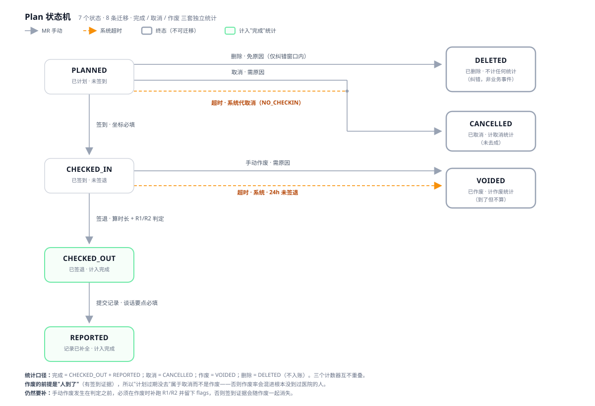

# 需求说明（最终版）

> 本文是「医药代表学术拜访」原型（`demo/`）的最终需求基线。原始题面见 [source-extracted.txt](./source-extracted.txt)，
> 需求演进与角色分析见 [角色模型.md](./角色模型.md)，作废/删除的取舍过程见 [作废设计的漏洞与补丁.md](./作废设计的漏洞与补丁.md)。
> **本文是功能描述的唯一权威**——早期初读稿与本文件冲突时，以本文为准。

---

## 0. 一句话

证明"拜访真的发生过、且过程合规"，并让三种角色在同一份数据上看到各自该看的东西。

## 1. 使用者（3 个演示身份 / 2 类角色）

| 身份 | 角色 | 数据范围 | 只关心 |
|---|---|---|---|
| 张伟 | 医药代表 MR | 本人 | 我的计划、签到签退、异常原因 |
| 李娜 | 医药代表 MR | 本人 | 同上（用于演示数据隔离） |
| 王敏 | 系统管理员 ADMIN | 全局 | 规则阈值、医院/医生/药品主数据、产品×月度看板 |

**数据隔离**：代表只能看到 `mr = 自己` 的拜访；管理员看到全量数据、但只读，不改拜访内容。

> **已裁掉的一层**：原设计里的「区域主管 DM」（团队范围、团队看板、异常复核）整层移除（2026-10-29）。
> 因此不存在 `team` 概念、没有团队维度统计、没有复核流。产品维度的月度看板由管理员承接。

## 2. 拜访的五个步骤

计划 → 签到 → 学术沟通 → 签退 → 反馈记录

第 3 步不产生状态迁移（它是签到与签退之间发生的事）。

## 3. 状态机

**7 个状态 · 8 条迁移 · 3 个终态**



矢量图源文件：`demo/assets/state-machine-v2.svg`；实现：`demo/logic.js` 的 `STATUS_LABELS` / `ACTIONS` / `checkTransition` / `statBucket`。

### 3.1 状态定义

| 状态 | 含义 | 可执行动作 | 统计归属 |
|---|---|---|---|
| `PLANNED` | 已计划，未签到 | 签到 / 修改 / 取消 / 删除（窗口内） | 未发生 |
| `CHECKED_IN` | 已签到，未签退 | 签退 / 作废 | 未发生 |
| `CHECKED_OUT` | 已签退，待填记录 | 补记录 | **完成** |
| `REPORTED` | 记录已补全 | —（冻结） | **完成** |
| `CANCELLED` | 已取消（未去成 / 超时未签到） | — | **取消** |
| `VOIDED` | 已作废（到了但不算） | — | **作废** |
| `DELETED` | 已删除（纠错） | — | 不入账 |

### 3.2 迁移规则（含守卫与失败码）

| # | 迁移 | 触发 / 操作人 | 前置条件 | 失败响应 |
|---|---|---|---|---|
| 1 | `PLANNED → CHECKED_IN` | MR 手动签到 | 坐标为必填且合法 | `409` 状态不符 · `400` 坐标非法 · `403` 非本人 |
| 2 | `CHECKED_IN → CHECKED_OUT` | MR 手动签退 | — | `409` · `400` 坐标非法 · `403` |
| 3 | `CHECKED_OUT → REPORTED` | MR 手动补记录 | 谈话要点非空 | `409` · `400` 要点为空 · `403` |
| 4 | `PLANNED → CANCELLED` | MR 手动取消 | **原因必填** | `409` 已签到不可取消 · `400` 缺原因 · `403` |
| 5 | `PLANNED → DELETED` | MR 手动删除 | **免原因**；`now < plannedAt − 1h` 且 `now − createdAt ≤ 1h` | `409` 窗口外或状态不符 · `403` |
| 6 | `CHECKED_IN → VOIDED` | MR 手动作废 | **原因必填** | `409` 已签退（窗口已关闭） · `400` 缺原因 · `403` |
| 7 | `PLANNED → CANCELLED` | **系统** | 计划时间 + 24h 仍未签到（cause=`NO_CHECKIN`） | 幂等；不处理已终态 |
| 8 | `CHECKED_IN → VOIDED` | **系统** | 签到 + 24h 仍未签退（cause=`TIMEOUT`） | 幂等；不处理已终态 |

**签退时的副作用**（迁移 2 的一部分，不是独立状态）：
服务端计算 `durationSec = checkoutAt − checkinAt` → 跑 R1/R2 → 固化 `evaluation`（含阈值与规则版本快照）→ 若命中则标记 `abnormal = true`。

**作废时的副作用**（迁移 6）：
用已有的签到时间与坐标**补跑 R2**，把结果写进作废记录（`void.flags`）——作废可以让这条拜访不计入完成，但不能让异常消失。

### 3.3 不变量

1. 时长只能由服务端用两个时间戳计算，且只有在 `CHECKED_OUT` 之后才存在。
2. 判定在签退时固化，并带阈值/规则版本快照；之后调整阈值**不回溯**。
3. 取消 / 删除 / 作废都**不物理删除**记录（删除是逻辑删除）。
4. `REPORTED` 没有任何出边——已完成即冻结。
5. 一条拜访最终只落进一个计数器；`DELETED` 不入账。

### 3.4 为什么这样切

| 设计点 | 理由 |
|---|---|
| 作废只从 `CHECKED_IN` 出 | 判定在签退时发生；若签退后仍可作废，等于"看到结果再撤销判定" |
| 计划超时归**取消**而非作废 | 作废的前提是"人到了"（有签到证据）；没去成的记成作废会污染作废率 |
| `DELETED` 是状态而不是字段 | 终态必须能被查询与审计；用字段过滤会让"计划执行率"的分母被任意收缩 |
| 取消与作废分开计数 | 取消率 = 行程/关系问题（可干预）；作废率 = 到了却没成（要查人） |
| `CHECKED_OUT` 独立存在 | "证据完整"与"记录完整"是两件事，审计要的是后者 |

## 4. 合规判定

```
R1  停留时长 < 300 秒        → DURATION_TOO_SHORT
R2  签到点或签退点 > 500 米   → LOCATION_DEVIATION（逐点判定，各生成一条）
abnormal = flags.length > 0
```

- **边界**：「不足 5 分钟」取严格小于；「500 米以上」取严格大于——恰好 300 秒 / 500 米合规。
- **快照**：判定结果存 `{flags, durationSec, distanceIn, distanceOut, rules:{阈值, 版本}}`。
- **作废补判**：作废发生在判定之前，必须补跑签到点距离，`flags` 存进作废记录。

## 5. 统计口径

| 指标 | 定义 |
|---|---|
| 完成 | `CHECKED_OUT` + `REPORTED` |
| 有效 | 完成 − 异常 |
| 异常率 | 异常 ÷ 完成 |
| 取消 | `CANCELLED`（独立计数，不进异常率分母） |
| 作废 | `VOIDED`（独立计数） |
| 删除 | 不入任何分母 |

- **范围**：同一套口径，两个范围——代表看板 = 本人（`mr = me`）；管理员看板 = 全量。没有第三个范围。
- 落月依据：签到时间；未签到（取消）按计划时间。
- 一次拜访不论命中几条规则，只记 1 次异常。
- 作废不进「异常率」分母，否则一次误签到会稀释覆盖率；异常留在分母里，否则异常率会被自己吃掉。

## 6. 时间规则（全部可配 + 版本化）

| 规则 | 默认 | 行为 |
|---|---|---|
| 创建时间不得早于当前 | — | 日期 `min` + 提交 400 |
| 1 小时内开始 | — | 创建需**二次确认**（提示"不能删除，只能取消"） |
| 删除窗口 | 创建后 1h / 距开始 >1h | 超出则按钮禁用，只能取消 |
| 悬挂超时 | 24h | 未签到 → 系统取消；未签退 → 系统作废 |
| 补记录时限 | 72h | 超时标「记录缺失」，进管理员待办（**不改状态**） |

## 7. 主数据

- **快照**：拜访落库时快照医生姓名/科室、药品名、医院名与坐标 —— 历史记录不依赖主数据现状。
- **逻辑删除**：`deleted_at` 标记，默认不展示，可恢复；**永不物理删除**。
- **停用 / 下线**：`status = INACTIVE`，仍可见、可再启用；被停用的不可被新计划选中。
- 二者区别：停用是"暂时不用"，删除是"录错了"。

## 8. 权限矩阵

| 能力 | MR | 管理员 |
|---|:--:|:--:|
| 创建 / 签到 / 签退 / 作废 / 补记录 | ✅ 本人 | ❌ |
| 查看拜访 | 本人 | 全量（只读） |
| 产品 × 月度看板 | 本人 | 全量 |
| 规则配置 | ❌ | ✅ |
| 主数据维护（医院/医生/药品） | ❌ | ✅ |
| 异常明细 / 待补记录（只读） | 本人 | 全量 |

越权一律 `403`（服务端判定，界面只是不给入口）。

## 9. 交互约定

1. **需要原因或需要确认的动作，一律弹对话框**，不在页面里展开表单。
2. 行内操作收进 `⋯` 菜单，**只列当前状态可执行的动作**；每行都有，内容随状态变。
3. 医院/医生/药品是可搜索下拉（输入即过滤，↑↓ 选择，回车确认，Esc 关闭）。
4. 时间用**日期 + 24 小时制时分**，不依赖浏览器 locale。
5. 身份切换放在独立的左侧轨道，与产品内容隔离。
6. 按钮禁用时给出原因，而不是让其凭空消失。

## 10. 审计需要留存的内容

| 类别 | 内容 | 现状 |
|---|---|---|
| 事实 | 签到/签退原始时间与坐标、停留时长、谈话要点、反馈、资料派发 | ✅ |
| 判定 | flags、阈值快照、规则版本、判定时间 | ✅ |
| 变更 | 修改/取消/删除/作废/补记录的原因、操作人、时间 | ✅ |
| 主数据 | 变更前/后值 | ⚠️ 只有删除标记，编辑无 before/after |
| 规则 | 版本、生效时间、操作人 | ✅ |
| 系统 | 超时扫描（取消/作废/记录缺失）逐条 | ⚠️ 有逐条日志，无批次记录 |
| 访问 | 查看/导出日志 | ❌ 本期不做 |

## 11. 明确不做

认证与权限系统（题面明确不要求，用固定身份模拟）、移动端适配、真实 GPS 采集、多租户、数据导出。

## 12. 验收清单

| # | 验收点 |
|---|---|
| 1 | 代表只能看到本人拜访；两个代表互相不可见 |
| 2 | 签到/签退时间由服务端生成，前端不可传 |
| 3 | 299 秒异常、300 秒合规；499.9 米合规、500.1 米异常 |
| 4 | 双重异常返回 3 项标记（R1 + 签到点 R2 + 签退点 R2） |
| 5 | 未签到签退、重复签到、未签退补记录 → 409 |
| 6 | 取消需原因；删除免原因但仅窗口内；作废仅已签到 |
| 7 | 作废时补判 R2 并写进作废记录 |
| 8 | 改阈值生成新版本，历史判定不变 |
| 9 | 主数据删除为逻辑删除，历史记录靠快照仍可读 |
| 10 | 看板五个数字与口径一致，删除不入账 |
